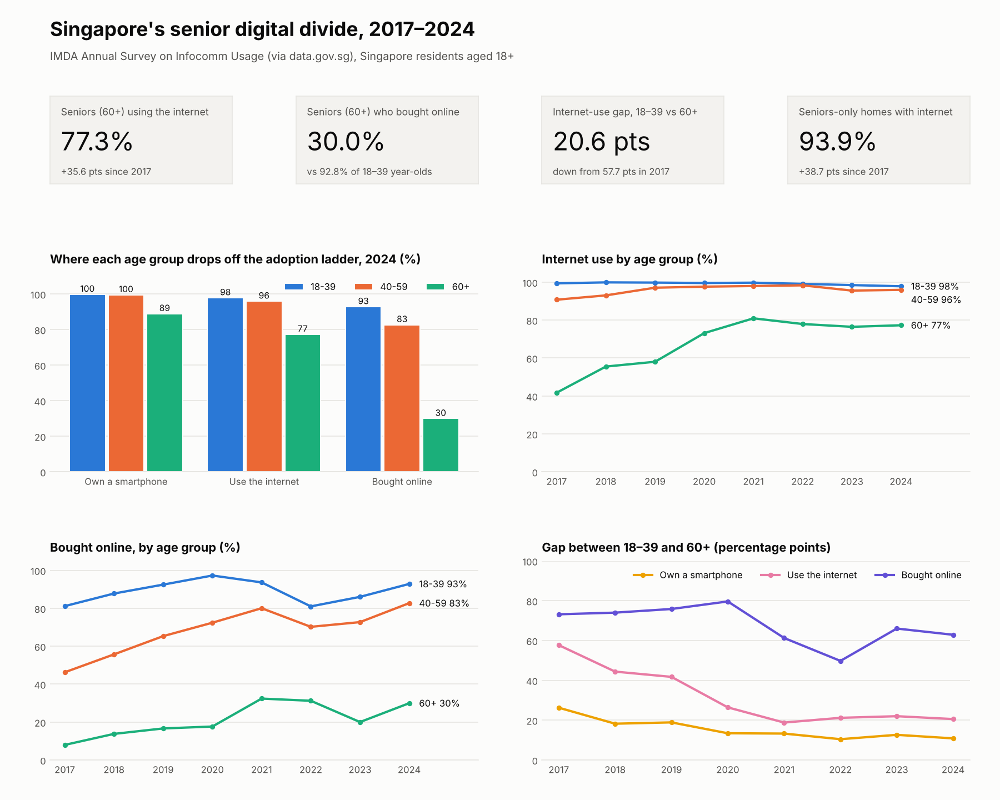
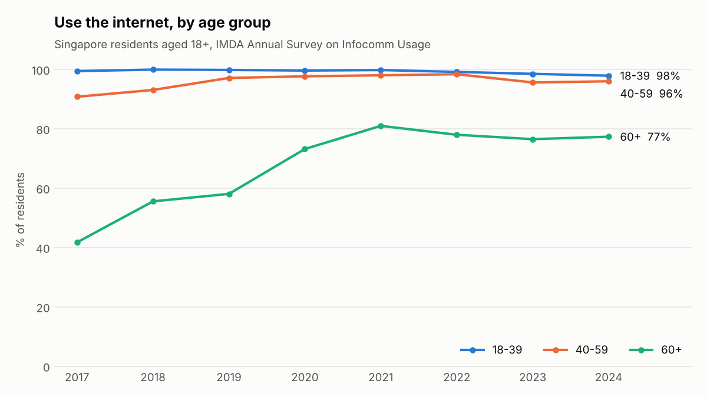
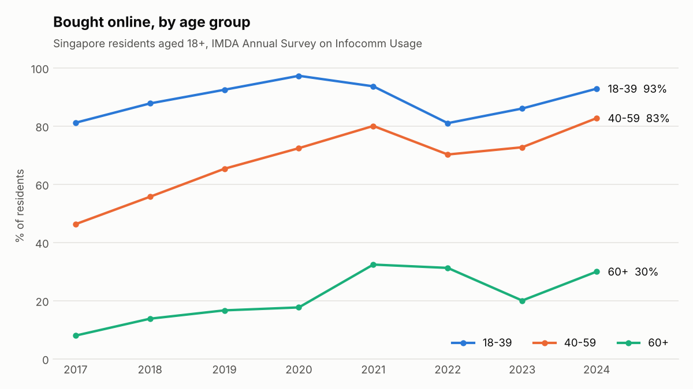

# Singapore's Senior Digital Divide, 2017–2024

How far have Singapore's seniors come in going digital, and where do they still fall behind?

This project analyses IMDA's *Annual Survey on Infocomm Usage* (published on data.gov.sg) to compare digital adoption across age groups. It looks at three steps: owning a smartphone, using the internet, and buying online.

**Stack:** Python (pandas) · SQL (DuckDB) · pytest · matplotlib



## Key findings

1. **Seniors' internet use nearly doubled.** Among residents aged 60+, internet use rose from 41.7% (2017) to 77.3% (2024). The gap with 18–39 year-olds narrowed from 57.7 to 20.6 percentage points.
2. **The biggest jump came in 2020.** Senior internet use rose 15.1pp from 2019 to 2020. That timing matches COVID-19 and the launch of national senior digital programmes, but this data alone can't show cause.
3. **Progress has stalled since 2021.** Senior internet use peaked at 80.9% in 2021 and was 77.3% in 2024.
4. **The divide has moved from access to confident use.** In 2024, 89% of seniors owned a smartphone and 77% used the internet, but only 30% bought anything online. The online purchase gap with 18–39 year-olds is still 62.9pp, and has closed by just 10.3pp since 2017.
5. **Home access is nearly solved.** Internet access in seniors-only households rose from 55.2% (2017) to 93.9% (2024).

**What this suggests:** the next step for digital inclusion is building seniors' confidence to transact online (payments, e-services, scam awareness), not just getting them connected.




## Data

| Indicator | data.gov.sg dataset | SingStat table |
|---|---|---|
| Smartphone ownership by age group | `d_65567444c3df02aceb795897bbd183c9` | M920321 |
| Internet usage by age group | `d_3f4bfee2d42f8fb3bea3218c01aa9902` | M920341 |
| Online purchase by age group | `d_c98105aa8d0585e55e44cd3d2c3384dd` | M920331 |
| Household internet access by composition | `d_66ad6d9200e5223a4773df8a615f0c5f` | M920301 |

Source: Info-communications Media Development Authority (IMDA), via SingStat and data.gov.sg, under the Singapore Open Data Licence. Coverage: Singapore residents aged 18+, 2017–2024.

> **Note:** `data/raw/` was checked value-by-value against the data.gov.sg API on 11 Nov 2026. Run `python scripts/download_data.py` to pull a newer survey year when IMDA publishes one.

## Pipeline

```
data/raw/*.csv  (wide: one column per year)
   │  src/pipeline.py: load, reshape to long, run checks
   ▼
DuckDB SQL models (sql/)
   ├── 01_stg_indicators        tidy indicator x segment x year
   ├── 02_mart_age_gap          18–39 vs 60+ gap and parity, per year
   ├── 03_mart_adoption_ladder  smartphone → internet → online purchase drop-offs
   └── 04_mart_gap_change       how much each gap closed, 2017 → 2024
   ▼
data/processed/*.csv  → outputs/dashboard.png + outputs/charts/*.png
```

### Data-quality rules (`src/checks.py`)

Errors stop the pipeline. Warnings are flagged for review.

| # | Rule | Severity |
|---|---|---|
| 1 | Every series label maps to a known segment | error |
| 2 | Each indicator has all expected segments | error |
| 3 | Full year coverage, 2017–2024 | error |
| 4 | No missing values (`na` is caught) | error |
| 5 | Percentages within 0–100 | error |
| 6 | One row per indicator × segment × year | error |
| 7 | The overall 18+ value lies within the age-band range (it's a weighted average) | error |
| 8 | Online purchase ≤ internet usage for the same group and year | warning |
| 9 | Year-on-year swings under 10pp | warning |

On the current data, rules 1–8 pass. Rule 9 flags 7 swings for review, including the 2020 jump in senior internet use and a dip in senior online purchases in 2023. Treat single-year moves in the online purchase series with care.

### Tests

21 pytest tests: each data-quality rule is shown to catch an injected issue, and the SQL models are checked for row counts, gap arithmetic and reconciliation back to staging.

## Run it

```bash
pip install -r requirements.txt
python scripts/download_data.py   # optional: refresh raw data from data.gov.sg
python -m src.pipeline            # checks + SQL models + export to data/processed/
python -m src.charts              # README charts
python -m src.dashboard_image     # one-page dashboard image
pytest                            # 21 tests
```

If you'd like a Tableau Public version too, build steps are in [`docs/tableau_guide.md`](docs/tableau_guide.md). Field definitions are in [`docs/data_dictionary.md`](docs/data_dictionary.md).

## Limitations

- These are survey estimates, published without confidence intervals, so small year-on-year changes may be noise.
- Age bands are broad. "60+" combines very different groups (60–64 vs 80+).
- Online purchase is only one kind of online transaction. This data doesn't show use of government e-services or e-payments, so "30% bought online" isn't the same as "30% transact online".
- Correlation in timing (e.g. 2020) is not evidence of what caused a change.
